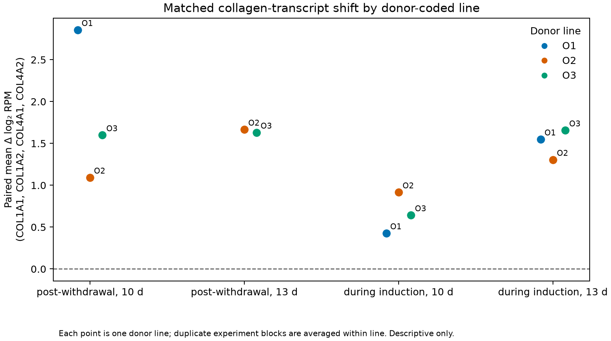
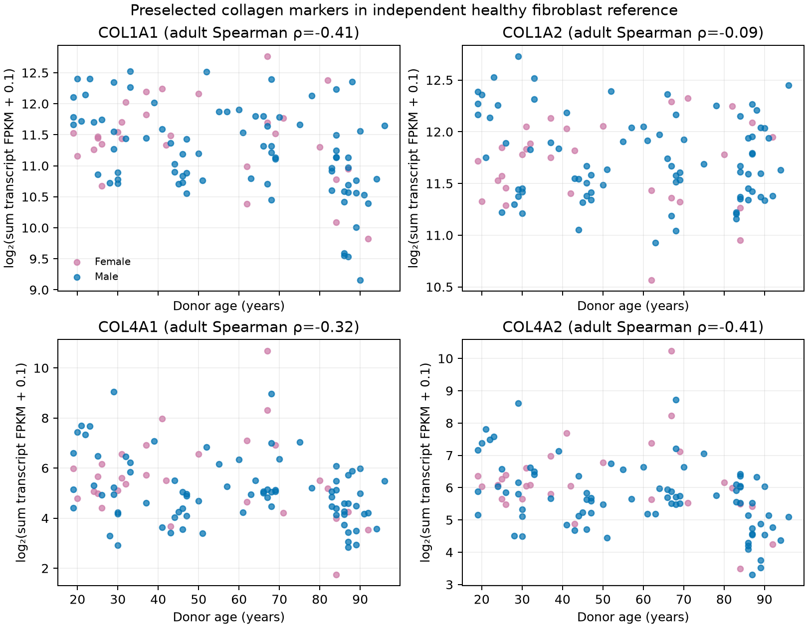

# Matched transcriptional collagen response after transient reprogramming

## Question and scope

Does the public RNA-seq series show a donor-matched collagen-transcript change
after maturation-phase transient reprogramming, and does that signal differ
between cells that successfully entered the reprogramming intermediate and
cells exposed to the factors but classified as failing to reprogram?

This is a focused re-analysis of [GSE165177](https://www.ncbi.nlm.nih.gov/geo/query/acc.cgi?acc=GSE165177),
the transient RNA-seq subseries of the [Gill et al. 2022 MPTR study](https://elifesciences.org/articles/71624).
The paper reports fibroblasts from three donor lines (ages 38, 53 and 53), and
uses 13 days as an optimal window for several transcriptome and epigenome
readouts. It separately measures collagen protein and cell migration. The
present analysis asks only whether the four collagen transcripts shown in its
Figure 3—COL1A1, COL1A2, COL4A1 and COL4A2—move in matched samples in the same
dataset. It does not estimate biological age.

## Data qualification and pairing

The two processed GEO tables contain 35,805 feature rows each and 24 and 71
sample columns, respectively. GEO's sample metadata has 95 records. Expression
columns use sample titles rather than GSM accessions, with underscores in the
expression files where the metadata sometimes uses spaces. A strict,
unique title normalization (case-folding and collapsing spaces/underscores)
maps all 95 expression columns to all 95 GEO sample records. The complete
header-to-GSM mapping and source SHA-256 hashes are in
[`geo_intake_receipt.json`](geo_intake_receipt.json).

The sample labels O1, O2 and O3 map to three donor lines; O1 and O2 are both
53-year donor lines, and O3 is 38. Experiment 1 and experiment 2 are kept as
separate blocks. Each comparison pairs treatment and reference samples only
within the same donor line, experiment block and induction duration. Where a
donor line has matched samples in both experiment blocks, the paired effects
are averaged within that line before summarizing across donor lines. The two
53-year lines remain separate donor lines; repeated experiment blocks are not
counted as additional donors.

The source methods distinguish two biological phases. “Transiently
reprogrammed fibroblasts” are collected after factor withdrawal and at least
four weeks of further culture; “transient reprogramming intermediate” samples
are collected during induction after sorting. The “failing” populations have
also been exposed to OSKM but do not show the selected intermediate marker
state. Negative controls were mock-infected and cultured alongside the
experimental cells. Comparisons across these phases are therefore reported
separately.

The deposited expression values are processed log2 RPM, not raw counts. For
each gene, duplicate feature rows (if present) are averaged within sample. The
four-gene panel score is the mean of the four matched gene-wise differences in
log2 RPM. A positive score means higher collagen transcript abundance in the
listed contrast condition. This compact descriptive score is not a validated
aging signature.

## Results

At 13 days, the post-withdrawal “transiently reprogrammed” samples had a
positive four-collagen panel difference versus the donor-, experiment- and
day-matched negative controls in both represented donor lines: O2 was +1.67
and O3 was +1.63 mean log2-RPM difference across the four genes. Each line has
two experiment-block pairs, which were averaged within line. The 13-day
post-withdrawal comparison includes only two of the three donor lines because
O1 has no corresponding successful endpoint sample in this RNA-seq series.

The 13-day “failed to transiently reprogram” endpoint was much closer to its
matched negative controls: the median donor-line panel difference was +0.29
(range −0.11 to +0.46 across three lines). This pattern separates the
post-withdrawal successful group from factor-exposed cells that failed to
enter the selected intermediate state in these data.

During active induction, the picture was different. At 13 days, the successful
intermediate group was +1.55 versus matched negative-control intermediates
across all three donor lines, while the failing intermediate group was +2.42.
Successful intermediates were −0.92 versus failing intermediates in all three
lines. Elevated collagen transcripts during induction are therefore not
specific to the successful intermediate label; the more relevant pattern is
the separation that remains after withdrawal and recovery culture.

The post-withdrawal successful group was also higher than its matched negative
controls at 10 days (+1.60 across three donor lines) and 17 days (+1.52 across
three lines). The 15-day comparison has only one represented donor line. This
four-gene panel therefore does not reproduce a unique 13-day optimum; it shows
a positive signal at several induction durations, with sparse 15-day coverage.

At the 13-day post-withdrawal endpoint, donor-median gene differences were
+1.02 for COL1A1, +0.39 for COL1A2, +2.78 for COL4A1 and +2.40 for COL4A2.
The panel increase is driven more strongly by the two type-IV collagen
transcripts than by COL1A2. These are transcript values only: this analysis
does not re-evaluate the paper's protein assay or wound-migration assay.



## Check against a separate age-reference cohort

To ask whether these four genes carry the same age direction in another
fibroblast cohort, I also qualified the 143-sample [GSE113957](https://www.ncbi.nlm.nih.gov/geo/query/acc.cgi?acc=GSE113957)
FPKM table and kept the 133 GEO records marked `disease: Normal`; the ten HGPS
records were excluded. The linked [Fleischer et al. paper](https://doi.org/10.1186/s13059-018-1599-6)
uses this cohort to study age prediction, but this analysis does not use or
rebuild its clock. I summed transcript-row FPKM values sharing the exact
gene-symbol annotation and calculated descriptive Spearman correlations.

Among 111 healthy adults aged 19–96, the age correlations were −0.408 for
COL1A1, −0.086 for COL1A2, −0.317 for COL4A1 and −0.409 for COL4A2. These
directions are opposite the positive day-13 post-withdrawal changes for all
four genes. However, in the narrower 35–60-year subset (25 people), the same
correlations were −0.093, +0.028, −0.022 and −0.063 (the sampled people were
37–60 years old). That near-zero pattern means this four-gene panel does not
establish a clear age-associated gradient in the age range of the MPTR donors.
The transcript changes may reflect a specific matrix program rather than a
general shift in biological age.

The negative adult trends for COL1A1, COL4A1 and COL4A2 also remained in the
adult male-only (n=82), female-only (n=29) and arm-skin (n=89) subsets; COL1A2
remained weak or near-zero. These are unadjusted sensitivity summaries, not
tests of sex-independent or site-independent aging. GEO metadata report one
normal donor (AG04059; [GSM3124624](https://www.ncbi.nlm.nih.gov/geo/query/acc.cgi?acc=GSM3124624))
as age 96, while the 2018 article text describes the cohort range as 1–94.
The calculations retain the GEO sample age and record the difference
explicitly.

Only the sign is compared across the two studies. GSE113957 FPKM and GSE165177
log2 RPM have different processing and units, and the panel was preselected
from the MPTR paper. This cannot validate an age clock or convert the observed
changes into years younger.



## Interpretation and limits

This is a reproducible, donor-matched consistency check on a paper's deposited
processed data, not independent replication. It supports a narrow conclusion:
the four collagen transcripts are higher in the successful post-withdrawal
fibroblast samples than in matched negative-control samples in the represented
donor lines, while the failed endpoint controls are close to baseline. The
intermediate-stage comparisons show why stage and cell-state controls matter.

The analysis does not re-train or validate a transcriptome age clock, estimate
“years younger,” test lifespan or whole-organism function, establish durable
health benefit, or assess safety. Three donor lines are a very small and
restricted biological sample; at 13 days the successful endpoint group has
only two lines. Because the RNA-seq files are log2 RPM, this analysis does not
run count-based differential-expression software or attach inferential
p-values. The reported collagen protein and migration outcomes come from the
source paper, not this computation.

## Reproduction

From the repository's running `workbench` container:

```bash
python /lab/workbench/studies/aging-state-2026-10-11/fetch_reprogramming_inputs.py
python /lab/workbench/studies/aging-state-2026-10-11/analyze_reprogramming_endpoints.py
python /lab/workbench/studies/aging-state-2026-10-11/fetch_aging_reference.py
python /lab/workbench/studies/aging-state-2026-10-11/analyze_fibroblast_age_reference.py
```

The input receipt records the GEO file hashes, parsing limits and sample-title
crosswalks for both datasets. The derived outputs are in
[`derived/reprogramming-paired-analysis/`](derived/reprogramming-paired-analysis/):
full 95-sample manifest, per-pair gene values, per-experiment panel effects,
donor-line aggregates, gene-level summaries, the separate 143-sample age
reference values and correlation tables, figures and JSON analysis receipt.
Large downloaded matrices remain in the local ignored data cache.

## Next evidence step

The next aging step should compare a broader, prespecified age-associated
transcript set and, separately, a published cross-cohort clock after auditing
its training features and batch-correction requirements. The present four-gene
response is too narrow to establish a younger overall cell state. The parallel
regenerative-medicine track should continue to evaluate native periodontal
attachment, tooth-forming organoids and functional stem-cell products against
their own structural endpoints.
