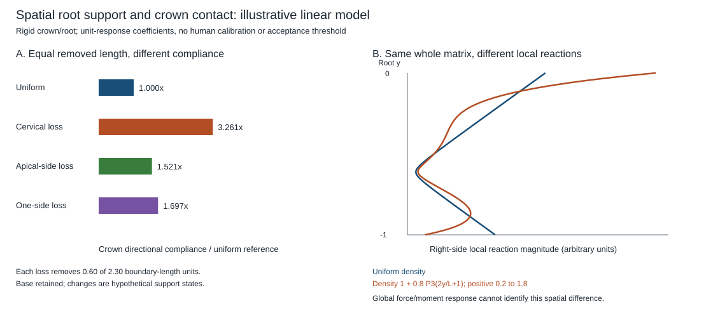

# Spatial mechanics, epithelial barriers and functional delivery

This batch advances the [persistent restoration goals](../restoration-run-plan-2026-10-11/GOALS_AND_CONTINUITY.md)
through an executed mechanics study and two source-data comparisons. The
mechanics outputs are illustrative calculations. The biological observations
belong to their original studies. They remain separate evidence classes.

| Lane | Engineering question | Required boundary |
| --- | --- | --- |
| [Geometry and attachment mechanics](mechanics/REPORT.md) | How do load location and the spatial pattern of support change translation, rotation and local reaction? | A rigid crown and prescribed elastic support do not model enamel/dentin thickness, biological healing or durable repositioning. |
| [Epithelial barrier](barrier/REPORT.md) | Which measurements qualify barrier performance, and which properties are still unmeasured? | Model lineage, geometry, tracer, normalization and sampling hierarchy govern transfer to native gingiva. |
| [Functional delivery](delivery/REPORT.md) | How closely does an accumulation readout track the relevant cargo-activity readout? | Organ, cell, animal, time and normalization must be qualified before inferring delivery coverage or repair. |

## Executed results

The mechanics solver evaluates 30 illustrative support/contact combinations.
For one horizontal reference contact, removing the same boundary length gives
compliance ratios of **3.261, 1.521 and 1.697** for cervical, apical-side and
one-sided loss, respectively. These are fixed-model response ratios, not human
mobility or recovery fractions. An exact manufactured example has the same
entire global stiffness matrix but different local reactions. Independent
force/moment and energy checks, analytical limits and discretization checks
verify the calculation rather than biological validity.

The [oral epithelial source](https://doi.org/10.1021/acs.molpharmaceut.4c01186)
provides aggregate model summaries. ALI/Submerged thickness differs by
**7.543-fold**, while electrical resistance-area product differs by
**1.016-fold** and standard FD20 apparent permeability is **0.577-fold**.
These are ratios of reported summaries, with missing paired-insert linkage.
The narrowed analysis uses noninfectious buccal-model measurements; it does
not establish restored gingival function. Other retrieved source material
remains unused after a source-processing stop, as documented in the report.

The [mouse delivery source](https://doi.org/10.1038/s41467-025-68103-7)
supplies six printed association summaries. Each compares a qPCR collection
time with a fixed 24-hour reporter endpoint. The reported R-squared differences
for 1-hour versus 24-hour qPCR are **+0.04, +0.05 and +0.12** across the three
selected series. Display-rounding bounds are separate from statistical
uncertainty; no new correlation is fitted. A source-described late qPCR organ
preference also disagrees with reporter location. Stable reporter history,
different measurement denominators and unknown animal/field linkage prevent
these signals from becoming intended-cell repair coverage.

## How this changes the next research decision

**Measure spatial mechanics as well as overall stiffness.** A crown contact
changes the moment delivered to the root support. Losing a specified amount
of support in different places need not produce the same response. Conversely,
matching a small set of global responses need not identify the underlying
support distribution. A local structural or reaction measurement may therefore
be needed in addition to global displacement. The model's verification and
nonidentifiability examples specify what its own measurements can resolve;
they do not establish a human injury diagnosis or physiological target.

The unloaded resting pose is an explicit model input. Retaining a prescribed
wrong pose under a static elastic calculation is not a simulation of biological
healing or post-support drift. Original tooth position, bite and mobility after
finite support withdrawal remain independent required outcomes. The earlier
[hard-tissue/interface studies](../checklist-integration-2026-10-19/materials/REPORT.md)
also retain the missing same-specimen actual-thickness and durability link;
rigid-crown calculations do not close it.

**Qualify the barrier measurement before using it to rank a construct.**
Electrical resistance and tracer transport describe different physical
readouts. Their geometry, blank/reference treatment, tracer properties and
follow-up need to remain visible. A construct's appearance, coverage or
identity-marker expression cannot fill an absent functional measurement.
Root coverage, gum volume, papillae, native attachment and long-term recurrence
remain separate goals.

**Separate access, cargo activity and repair.** A tissue-level signal does
not itself give the fraction of intended cells reached or functionally
corrected. Even a cargo-activity reporter is not the organ's useful repair
function. Preserve whichever formulation, animal, tissue and temporal links
the source actually supplies; missing crosswalks stay missing. This supports
the organoid, genome-repair and tissue-delivery goals without claiming oral
availability or a universal body-wide intervention.

## Continuity

The [linked-outcome batch](../checklist-integration-2026-10-19/README.md)
retains the five-patient pulp observations and single-patient clinical
base-editing summary analysis. The
[functional benchmarks](../checklist-function-2026-10-19/README.md) retain
human PDL mechanics and MOTS-c assay qualification. Earlier SS-31, caffeine,
rapamycin, SLU-PP-915 and peptide-modification questions remain in the
continuity record.

The full target remains restoration of natural tooth substance, thickness,
architecture, pulp and sensation; cementum, PDL, socket, gums and barrier;
intended form, position and bite; and durable function after finite support
withdrawal. Whole-body youthful function, identity, genomic integrity,
organoids and stem cells remain in scope. This batch establishes neither a
complete restoration treatment nor demonstrated rejuvenation.
