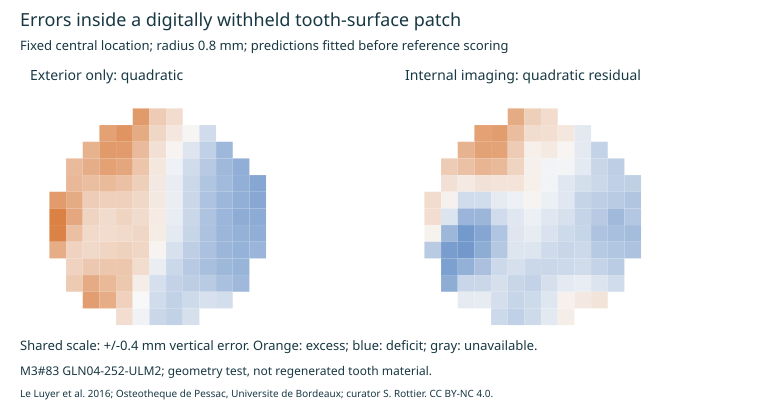

# Reconstructing digitally withheld tooth-surface patches

Agent-run computational research, 2026-10-17; personal project with AI
assistance. One public reference tooth, synthetic surface omissions, no
personal photographs or clinical records. No biological repair was performed.

## Result

The experiment reconstructed **nine withheld patches with four fixed
methods**, producing 36 complete comparisons. The exterior-only quadratic
baseline had a mean of patch-level vertical-height MAEs of **0.111 mm**.
Adding the source internal enamel-dentine junction (EDJ) through a quadratic
residual model improved five patches and worsened four; its corresponding
mean was **0.125 mm**. Additional internal geometry did not consistently
improve this particular reconstruction model.

Halving the sampling interval from 0.125 to 0.0625 mm retained that five/four
split and the ordering of the four methods' mean MAEs. The largest paired
patch/method MAE change was 0.00635 mm. This checks numerical sampling of the
supplied surfaces, not anatomical measurement accuracy.

These are exploratory baselines on one tooth. Nine overlapping regions and
two grids do not constitute independent biological replication. There is no
clinical success threshold, claim of original personal-anatomy recovery or
enamel-regeneration result.

## Reference and information allowed

The [paired-surface audit](PAIRED_TOOTH_SURFACE_REFERENCE.md) qualifies
**M3#83 GLN04-252-ULM2** provisionally for geometry development. Source:
[Le Luyer et al. 2016, model DOI 10.18563/m3.sf.83](https://doi.org/10.18563/m3.sf.83),
[associated dataset article](https://doi.org/10.18563/m3.2.1.e1),
[primary study](https://doi.org/10.1371/journal.pone.0159688).
Its source segmentation, smoothing, unresolved specimen-specific sampling,
open crown boundary and degenerate EDJ triangle remain limitations. Raw
surfaces were not re-adjudicated against scans here.

Both branches receive the supplied pose, nominal metric scale and **full
reference XY bounding extent**. These are privileged inputs, not recovered
camera parameters or scale from historical photographs. The exterior branch
receives only the retained OES geometry. The internal-imaging branch also
receives the separately supplied EDJ in its shared pose, including beneath
the withheld patch. An exterior-only method cannot inherit that information.

## Fixed experiment and separation of prediction from scoring

The [primary plan](patch_reconstruction_plan.json) was written before the
patch experiment's reference evaluation. It is not an independently
preregistered or externally blinded study. Earlier exploratory inspection of
the source reference remains part of the project history.

- Three locations use XY bounding-extent fractions (0.35, 0.50), (0.50,
  0.50) and (0.65, 0.50). These computational locations are not verified
  clinical landmarks or outcome-selected cusp peaks.
- Each location is evaluated at radii **0.4, 0.8 and 1.2 mm**, corresponding
  to nominal disk widths 0.8, 1.6 and 2.4 mm.
- Remove **every OES triangle whose XY projection intersects the disk**,
  including triangles covering the disk with all vertices outside it. Merely
  withholding vertices would leak some hidden surface through spanning faces.
- Sample visible support in the annulus from radius + 0.15 mm to radius +
  1.0 mm. Rasterize support only from retained faces. The guard distance and
  fit settings are fixed across patches.
- Query every regular-grid point inside the disk. At the primary grid,
  patches have 30-288 query points and 330-611 support points. The information
  branches have equal support counts in this run; no case or method was
  dropped because of its score.
- Fit a plane or quadratic polynomial to visible OES heights. For the
  internal-imaging variants, fit the corresponding polynomial to visible
  **OES-minus-EDJ vertical gaps**, then add the supplied EDJ query heights.
  These gap models are mathematical priors, not developmental enamel models.
- Write coefficients, support/query hashes and prediction hashes to
  [`prediction_receipts.json`](derived/missing_tooth_patches/prediction_receipts.json)
  **before** rasterizing the full OES reference for evaluation. No withheld
  outer height enters model fitting or method selection.

A mutation test changes private withheld vertex heights by 1,000 nominal
units and verifies that retained-surface inputs do not change while full
reference targets do. Analytic-plane/quadratic tests separately check that
the numerical method can recover surfaces it is capable of representing.
These checks validate data flow and implementation, not independent clinical
performance.

## What the error means

The surface is represented as the highest z intersection at each XY ray:
a **2.5D top envelope**, not a full 3D tooth reconstruction. Pose axes are
computational coordinates. Reported distances are vertical height errors,
not nearest-surface distances, prism-path distances or full 3D enamel
thickness. Undercuts, lateral fracture faces and internal cavities are outside
this representation.

MAE and RMSE use all query points. Positive and negative errors are integrated
separately over grid-cell area to produce excess/deficit **envelope-volume
proxies**. These are not measured missing or regenerated enamel volumes.
Signed cancellation cannot erase those separate deficits. Incomplete target
or prediction coverage would be retained as an unscored row, with counts;
all 36 primary comparisons had complete coverage.

## Primary results: both quadratic models, every patch

Values are calculated vertical-height MAEs, in nominal micrometres. Display
precision is numerical, not a claim of micrometre anatomical accuracy.

| Location | Radius | Exterior quadratic | Internal-imaging quadratic residual |
|---|---:|---:|---:|
| 1 | 0.4 mm | 60.9 | 45.8 |
| 1 | 0.8 mm | 154.3 | 125.4 |
| 1 | 1.2 mm | 201.2 | 311.5 |
| 2 | 0.4 mm | 60.3 | 46.6 |
| 2 | 0.8 mm | 134.5 | 98.0 |
| 2 | 1.2 mm | 203.5 | 128.8 |
| 3 | 0.4 mm | 25.4 | 38.7 |
| 3 | 0.8 mm | 45.7 | 113.7 |
| 3 | 1.2 mm | 114.9 | 218.2 |

The exterior-only quadratic model's maximum point error reaches **0.709 mm**;
the internal-imaging quadratic variant reaches **0.955 mm**. The internal
plane-residual variant reaches **1.140 mm** despite its lower mean MAE than
the exterior plane. Keep local failures alongside overall means.

All four methods, coverage counts, signed bias, MAE, RMSE, maximum error and
separate volume proxies are in
[`patch_errors.tsv`](derived/missing_tooth_patches/patch_errors.tsv).



The figure always shows the second location at radius 0.8 mm, with a common
color scale for the two models. This display location was fixed in the
script; it is not the best, worst or representative population result.

## Post-hoc numerical-resolution sensitivity

The [second plan](patch_reconstruction_density_sensitivity_plan.json) explicitly
records its post-hoc status. Only grid spacing changes; all locations, radii,
support margins and methods are retained. Each model is refitted from the
finer visible support, and all 36 comparisons remain scored.

| Method | Mean patch MAE, 0.125 mm grid | Mean patch MAE, 0.0625 mm grid |
|---|---:|---:|
| Exterior plane | 0.2256 mm | 0.2257 mm |
| Exterior quadratic | 0.1112 mm | 0.1112 mm |
| Internal-imaging plane residual | 0.1670 mm | 0.1672 mm |
| Internal-imaging quadratic residual | 0.1252 mm | 0.1240 mm |

Both grids sample an already segmented/smoothed source surface. Similar
answers under resampling do not validate its biological boundaries or permit
assessment of 2-10 micrometre repair layers. Per-case outputs and prediction
receipts for the finer run are retained in
[`density_sensitivity/`](derived/missing_tooth_patches/density_sensitivity/).

## Decision for the restoration project

The computational test now distinguishes three requirements: supplied
anatomical evidence, a model capable of representing local shape, and
regional error at the withheld surface. This run supports preserving the
exterior-only quadratic baseline and challenging the assumption that a smooth
thickness trend over the EDJ reconstructs regional enamel geometry reliably.
It does not select a clinically best reconstruction algorithm.

Next, freeze these methods and compare them on additional separately
qualified teeth before changing shape priors. Then evaluate richer priors
with specimen-level separation and region-level uncertainty. A method that
fails on a cusp or ridge cannot offset that error by matching another patch.
Actual historical scans/photos and current internal imaging would require
their own visibility, registration, uncertainty and privacy qualification.

Geometry is one input to the [full-tooth restoration target](FULL_TOOTH_RESTORATION_BLUEPRINT.md).
Replacing the proposed volume still requires enamel/dentin identity,
architecture, host-interface strength, crack integrity and coordinated
attachment/pulp function. These numerical reconstructions establish none of
those biological/material endpoints.

## Reproduce and credit

With the source reference fetched by `analyze_paired_tooth_surfaces.py --fetch`
and NumPy available, run from the repository:

```text
python studies/periodontal-attachment-restoration-2026-10-11/benchmark_missing_tooth_patches.py
python studies/periodontal-attachment-restoration-2026-10-11/benchmark_missing_tooth_patches.py --plan studies/periodontal-attachment-restoration-2026-10-11/patch_reconstruction_density_sensitivity_plan.json --out studies/periodontal-attachment-restoration-2026-10-11/derived/missing_tooth_patches/density_sensitivity
python -m unittest discover -s tests -p test_missing_tooth_patches.py -v
```

Credits: **Le Luyer M., Coquerelle M., Rottier S., Bayle P. (2016), M3#83,
GLN04-252-ULM2**, DOI 10.18563/m3.sf.83; associated dataset article
10.18563/m3.2.1.e1 and primary study 10.1371/journal.pone.0159688. We
acknowledge the **Osteotheque de Pessac, Universite de Bordeaux, France**,
and curator **Dr Stephane Rottier**. Source-derived outputs retain
[CC BY-NC 4.0 attribution and reuse terms](derived/missing_tooth_patches/README.md).
No personal records, external messages or scientific-journal submissions
were involved.

Validation: all **12 patch-study tests passed** with the NumPy runtime. The
full default-host suite reported **532 tests, OK, 74 skipped**; its skips
include these optional tests executed separately. Both output sets have
verified plan/prediction hash chains, complete coverage and matched support
counts. The generated figures and local document links were checked. Docker's
`workbench` service was not running; no successful doctor result is claimed.
