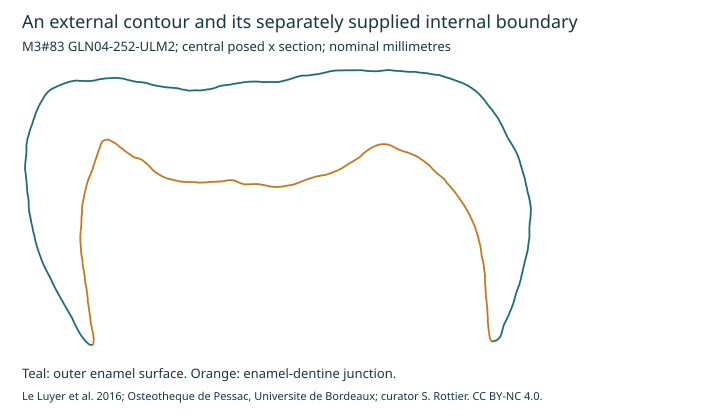

# Paired enamel/junction reference and regional thickness sensitivity

Agent-run computational analysis, 2026-10-17. Personal research with AI
assistance. No personal images or clinical records were used.

## Outcome

We now have a **provisional paired-surface geometry reference**: an outer
enamel surface (OES) and a separately supplied enamel-dentine junction (EDJ).
This advances the [outline-only pilot](TOOTH_TARGET_RECONSTRUCTION_PILOT.md)
by making an internal boundary available to the computation. It does not
recover a person's historical anatomy or independently establish tissue truth.

The regional sensitivity result matters more than an attractive outline:
synthetic 50-micrometre shifts of the internal contour leave the exterior
unchanged and change individual gap measurements by almost 50 micrometres.
For two of the three sections, the arc-weighted mean changes by less than one
micrometre. Regional errors can therefore be concealed by an overall mean.
These are deliberate geometric perturbations, not measured annotation errors
or biologically plausible new tissue states.

## Candidate selection and source qualifications

The [candidate ledger](hard_tissue_reference_qualification.tsv) retains both
useful inputs and exclusions. The small
[PCNN release](https://doi.org/10.6084/m9.figshare.3362125.v1) contains 271
RGB TIFFs in three folders; all channels are identical and individual slices
have 7-213 intensity values. No separate annotation files were located. Its
[paper](https://doi.org/10.1371/journal.pone.0157694) describes dentist-made
labels, but those labels were not identified in the inspected release.
Physical sampling is also unresolved; we did not reinterpret intensity values
as tissue labels or invent a corrected pixel scale.

The [LMU SWIR dataset](https://doi.org/10.5282/ubm/data.477) is a separate
damaged-tooth lead. Its readme reports manual internal segmentation and
32-micrometre voxels, but micro-CT was acquired after preparation at T2. The
public metadata/notebook were inspected; the full archive and its labels
were not acquired. A historical pre-damage 3D target does not follow from it.

For the selected MorphoMuseuM dataset, inspect models in ascending ID order
and require an adult, source maturation stage H, wear stage 1, and no
reconstructed-tip flag. This selects **M3#83, GLN04-252-ULM2**, before viewing
its gap results. M3#75 was inspected earlier but excluded because it is a
developing tooth. Selection is for a geometry reference, not a population
sample or a model of youthful tissue biology.

[Le Luyer et al.'s primary study](https://doi.org/10.1371/journal.pone.0159688)
identifies the selected tooth as an adult male's upper left second molar,
age greater than 30, stage H and wear stage 1. The archaeological study uses
threshold segmentation with manual corrections and constrained surface
smoothing; scan voxel sizes across its specimens range from 17.93 to 36.18
micrometres. The selected specimen's exact native voxel size was not recovered.
The [associated dataset article](https://doi.org/10.18563/m3.2.1.e1) and
[model record](https://doi.org/10.18563/m3.sf.83) identify the paired surfaces.
These are source-produced annotations, independent of our algorithm; they
have not been independently re-adjudicated here against raw scans.

## Digital intake results

The selected 4,030,861-byte ZIP has SHA-256
`d475ce2ef330417bafb0029f42a11a2c07e56163a98dec42424d9997c41177c8`.
Each model and pose file has its own hash in the
[machine-readable summary](derived/paired_tooth_surfaces/paired_surface_summary.json).

| Audit item | OES | EDJ |
|---|---:|---:|
| Vertices | 125,493 | 82,695 |
| Triangles | 250,205 | 164,609 |
| Open boundary edges | 779 | 779 |
| Edges incident to more than two faces | 0 | 0 |
| Inconsistent winding at internal edges | 0 | 0 |
| Zero-area triangles | 0 | 1 |

The two boundaries have identical coordinate sets, consistent with a shared
cervical cut. Both pose files specify the same rigid transforms. Source
coordinates are retained in nominal millimetres, following the item readme
and [dataset instructions](https://morphomuseum.com/directContribution).
The readme's maximal length is 11.52 mm; the posed OES bounding-box maximum
extent is 11.49 mm. The definition of the former is unspecified, so no
rescaling or accuracy estimate is imposed to make them agree.

Neither individual surface is closed. We did not calculate solid volumes by
silently capping them. A future combined enamel-shell volume calculation
would require verified boundary welding, orientation and self-intersection
checks. The degenerate EDJ face is retained in the audit. Raw-scan correctness,
self-intersection and repeat segmentation remain unassessed.

## What was measured

Three fixed central section planes pass through the midpoint of the posed
OES extent along x, y and z. Their axis names are computational coordinates,
not verified clinical buccolingual/mesiodistal landmarks. Triangle/plane
intersections produce OES and EDJ contours. For every OES segment midpoint,
we compute its shortest distance to any EDJ segment **within that plane**.
Means and quantiles are weighted by OES segment length.

This is a sectional contour-gap statistic. It is not full 3D local thickness,
a prism-path measurement, or the paper's enamel-volume/EDJ-area AET metric.
A section can miss a nearer point outside its plane. Material identity,
microarchitecture and repaired interfaces are separate questions.

| Central plane | Arc-weighted mean gap | Arc-weighted median | Arc-weighted 10th-90th percentile |
|---|---:|---:|---:|
| x | 1.147 mm | 1.246 mm | 0.456-1.680 mm |
| y | 1.296 mm | 1.527 mm | 0.382-1.793 mm |
| z | 1.176 mm | 1.158 mm | 0.991-1.361 mm |

Splitting every outer segment into four changes the corresponding mean by
0.007-0.013 micrometres. This checks numerical integration on the supplied
mesh; it does **not** establish comparable anatomical measurement accuracy.



## Deliberate internal-boundary sensitivity

For each section, hold its OES contour fixed and shift the EDJ contour by
-50, -20, +20 and +50 micrometres along a predeclared in-plane axis. The
zero-shift baseline plus four shifts gives fifteen configurations. A rigid
contour shift can cross the exterior near thin regions; it is a measurement
stress test, not a generated candidate anatomy. We do not assign these
perturbations probabilities or call them confidence intervals.

| Section | Mean-gap change at -50 micrometres | Mean-gap change at +50 micrometres | Largest local absolute change |
|---|---:|---:|---:|
| x | -0.225 micrometres | +0.724 micrometres | Approximately 50 micrometres |
| y | +33.909 micrometres | -33.548 micrometres | Approximately 50 micrometres |
| z | +0.386 micrometres | -0.138 micrometres | Approximately 50 micrometres |

All configurations are in the
[sensitivity table](derived/paired_tooth_surfaces/section_gap_sensitivity.tsv).
These sections and perturbations are repeated observations of one specimen,
not independent people or regeneration experiments.

## Consequence for the restoration target

Require separate regional assessments of external geometry and internal
boundary error. An exterior-only photo reconstruction cannot inherit this
source-defined EDJ. Neither a small overall gap bias nor an unchanged outline
can substitute for local error maps and independently supported anatomy.

The source's tens-of-micrometres native sampling range and unquantified
segmentation/smoothing errors do not qualify this reference to validate
2-10 micrometre repaired layers. Use it for geometry-method development and
withheld-region tests; use separately qualified microscopy/material assays
for the [thin-layer growth comparison](ENAMEL_SCALE_AND_INTERFACE_COMPARISON.md).

The next computation should remove predeclared patches from the source
surface, reconstruct only from the retained geometry and permitted views,
and score against the withheld surface. Keep the EDJ hidden from an
exterior-only branch and expose it only in a separately labeled branch with
internal imaging. This will test recovery of missing substance geometry;
it will not by itself demonstrate biological repair.

## Reproduce and credit

From the repository, with Python and NumPy available:

```text
python studies/periodontal-attachment-restoration-2026-10-11/analyze_paired_tooth_surfaces.py --fetch
python -m unittest discover -s tests -p test_paired_tooth_surfaces.py -v
```

The source ZIP is pinned by SHA-256. Raw models remain in ignored local
storage. The [derived-data notice](derived/paired_tooth_surfaces/README.md)
marks the source-derived outputs as CC BY-NC 4.0 and records their provenance.
Credit: **Mona Le Luyer, Michael Coquerelle, Stephane Rottier and Priscilla
Bayle (2016), M3#83 GLN04-252-ULM2**, associated MorphoMuseuM article
10.18563/m3.2.1.e1 and primary article 10.1371/journal.pone.0159688.
Physical collection: **Osteotheque de Pessac, Universite de Bordeaux, France;
curator Dr Stephane Rottier**. The item readme requests informing the curator
when a scientific article involving the specimen is published; that
requirement is recorded for any future manuscript. No external messages or
journal submissions were made in this run.

Validation: all **12 study tests passed** in the NumPy-enabled runtime. The
full default-host workbench suite reported **520 tests, OK, 62 skipped**;
those skips include the 12 optional tests executed separately. The source
archive hash, generated JSON/TSV structure and local document links were
checked, and the generated SVG was rendered and visually inspected. The
Docker `workbench` service was not running; no successful doctor check is
claimed.
