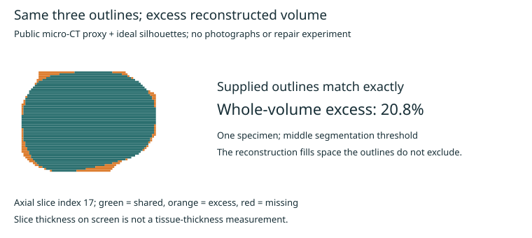

# Original-anatomy target: first public-data geometry pilot

Agent-run analysis, 2026-10-17. Personal computational research with AI
assistance. No owner/patient photographs, histories or clinical records were
used. This tests an elementary geometric baseline, not regeneration.

## Result and consequence

On one sampled public tooth scan, a reconstruction from three exact,
orthogonal silhouette projections matched every supplied outline perfectly
but contained **20.8% excess volume** relative to the segmented outer-envelope
proxy. Its volumetric intersection-over-union (IoU) was **0.828**. Across three
fixed intensity thresholds, excess volume ranged from **20.5% to 21.2%**.

This is a counterexample to accepting outline agreement as proof of original
3D anatomy. It is the error of this baseline, not a lower bound on what all
photo-reconstruction methods can achieve. Texture, shading, additional views,
scans and individual anatomical constraints can supply information this
baseline deliberately does not use. Internal tissue boundaries still require
separate evidence.

## Reference and integrity

[Pereira, Tonelli, Antunes, Miranda and Silveira, ds-uct-002](https://doi.org/10.5281/zenodo.3877625)
provide pre- and post-instrumentation micro-CT data under
[CC BY 4.0](https://creativecommons.org/licenses/by/4.0/). This pilot uses only
Tomo1B, before the dataset's simulated root-canal procedure. The specimen's
prior health, age and pristine/intact status have not been qualified. It is a
captured-shape reference, not an individual's original undamaged tooth.

The record and outer ZIP name indicate 20 micrometres; an internal directory
misleadingly contains `10um`. The acquisition header reports `Pixel Size =
20.002117`, consistent with the record. We assume that scalar value is
isotropic before subsampling; no independent calibration was performed.

The fetcher retrieves every sixteenth TIFF in filename order: **64 of 1,018
slices**, plus the header. Each retrieved member passes its ZIP CRC32 and has
a recorded SHA-256. Exact HTTP byte ranges, URLs, source hashes and the local
manifest hash are retained in the [summary](derived/tooth_silhouette_pilot/summary.json).
The entire 253 MB archive was not downloaded or MD5-verified. The declared
archive MD5 is retained as publisher metadata, not claimed as a performed
check. Raw data and actual-fetch provenance remain in ignored local storage.

## Method and favorable assumptions

1. Average each four-by-four native pixel block without slice-specific
   normalization. Effective grid spacing is approximately **320 x 80 x 80
   micrometres** in z/y/x.
2. Use fixed grayscale thresholds 65, 80 and 95. Keep the largest
   six-connected component; fill enclosed holes in individual axial slices.
   This deliberately creates an **outer-envelope proxy**, excluding enclosed
   pulp/canal space from the geometric comparison. It is not an expert tissue
   segmentation. Open concavities are retained; hole filling can alter some
   anatomy and the coarse z sampling can miss features.
3. For each proxy, derive exact binary orthographic silhouettes along z, y
   and x. Run every nonempty combination: seven configurations per threshold.
4. Intersect silhouette extrusions within a shared grid. The full-reference
   bounding extent, scale and perfect alignment are supplied to every run.
   This is privileged reference information; the run does not solve camera
   calibration or scale recovery from photographs.
5. Compare voxel occupancy with the corresponding threshold-specific proxy.
   Report supplied and withheld silhouette agreement, volumetric IoU and
   excess/missing volume separately. No clinical acceptance margin is set.

These are images of an isolated tooth with exposed roots, not realistic
views available in an intact mouth. Opposite orthographic silhouettes carry
the same occupancy information, so the number of projection axes is not the
number of ordinary photographs.

## All configurations at the middle threshold

IoU = intersection divided by union; 1 means identical masks. All supplied
silhouettes have IoU 1.000. Excess volume is relative to the reference proxy,
whose illustrative volume at this threshold is 218.3 cubic millimetres.

| Supplied axes | Volume IoU | Excess volume | Worst withheld silhouette IoU |
|---|---:|---:|---:|
| z | 0.442 | 126.2% | 0.562 |
| y | 0.439 | 128.0% | 0.565 |
| x | 0.524 | 90.8% | 0.666 |
| z + y | 0.592 | 69.0% | 0.584 |
| z + x | 0.645 | 55.0% | 0.693 |
| y + x | 0.766 | 30.6% | 0.753 |
| z + y + x | 0.828 | 20.8% | No withheld axis |

Missing volume is zero by construction: exact silhouette extrusion contains
the reference. This is not evidence of successful restoration. The remaining
volume is unexcluded space, not tissue predicted to exist. There are no
confidence intervals or population estimates; thresholds are sensitivity
analyses on the same tooth, not independent biological replicates.



The displayed axial cross-section is selected deterministically as the one
with the greatest reference area; the reported scores use the full proxy
volume. All 21 configurations are in
[`silhouette_metrics.tsv`](derived/tooth_silhouette_pilot/silhouette_metrics.tsv).

## What this changes in the restoration project

Historical photographs remain useful constraints on visible original form.
Each region must retain its evidence class: measured, image-constrained,
individual inference, external prior or unknown. Do not relabel a generated
hidden surface as a recovered personal measurement.

The present coarse grid cannot test 2-10 micrometre enamel growth or recover
enamel thickness. Two hypothetical enamel/dentin labelings can share exactly
the same external shape; a unit test records that ambiguity without pretending
either labeling was measured in this specimen.

Published photo reconstruction is a separate, promising benchmark lead:
[TeethDreamer](https://arxiv.org/abs/2407.11419) reports paired photographs and
surface scans, generated-view priors and held-out surface comparisons. We did
not run or reproduce it. Its repository reports testing on a 40 GB A100;
weights were not downloaded. Code licensing does not automatically settle
rights for every linked dataset or checkpoint. Its surface output cannot
establish a hidden enamel-dentin boundary.

## Next discriminating work

First qualify intact crown coverage and an independently reviewed
enamel/dentin boundary in a higher-resolution public reference. The current
pre-instrumentation label does not meet that requirement. Then freeze
withheld surface patches and views, compare scan-constrained reconstruction
against silhouette and anatomical-prior baselines, and measure regional
surface error and uncertainty coverage on other specimens. Keep specimens
and donors disjoint if learning or tuning is introduced.

Evaluate enamel-growth depth and interfaces separately using the
[materials comparison](ENAMEL_SCALE_AND_INTERFACE_COMPARISON.md). A good
geometric reconstruction supplies a proposed target; it does not make a
method capable of manufacturing that target or repairing living attachment.

## Reproduce

Study dependencies: Python, NumPy and Pillow. This run used Python 3.12.14,
NumPy 2.3.5 and Pillow 12.3.0 from the local bundled runtime. No new methods
package or GPU service was created. From this repository:

```text
python studies/periodontal-attachment-restoration-2026-10-11/fetch_tooth_reference.py
python studies/periodontal-attachment-restoration-2026-10-11/benchmark_tooth_silhouettes.py
python -m unittest discover -s tests -p test_tooth_silhouette_benchmark.py -v
```

The default host runtime may lack optional NumPy; use a runtime with these
dependencies to execute all ten study tests. General workbench tests do not
install them automatically. The Docker `workbench` service was not running
when checked; no successful `regen doctor` result is claimed.

Validation: all **10 study tests passed** with the dependency runtime. The
default host's full suite reported **508 tests, OK, 50 skipped**, including
seven optional geometry tests skipped there and executed successfully in the
separate study run. The generated cross-section SVG was rendered and visually
checked. The two repeated-growth microscopy panels and caption were also
visually inspected in the original supplement.
